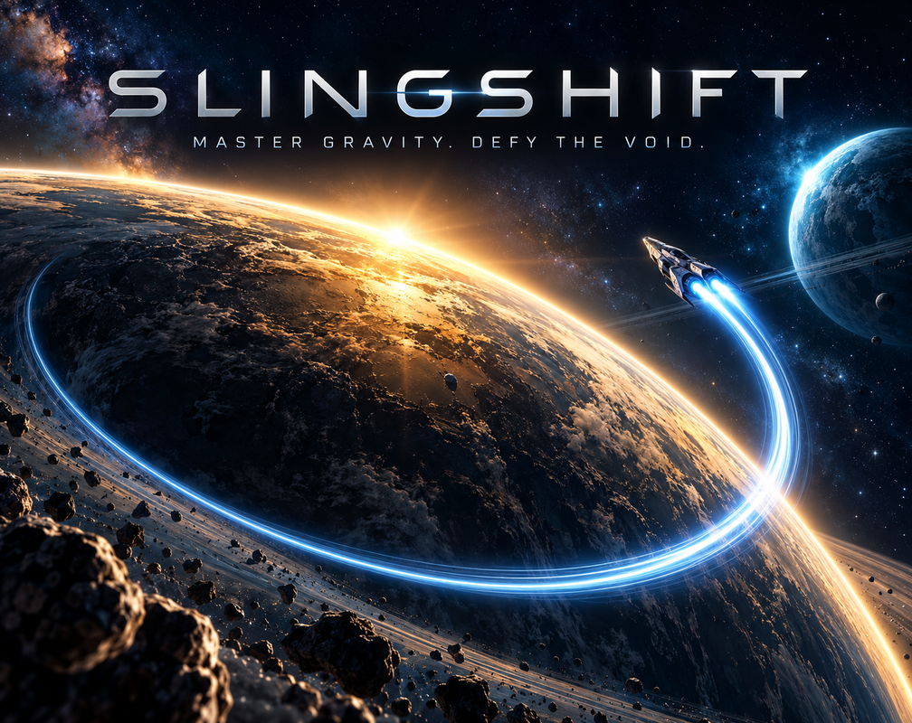
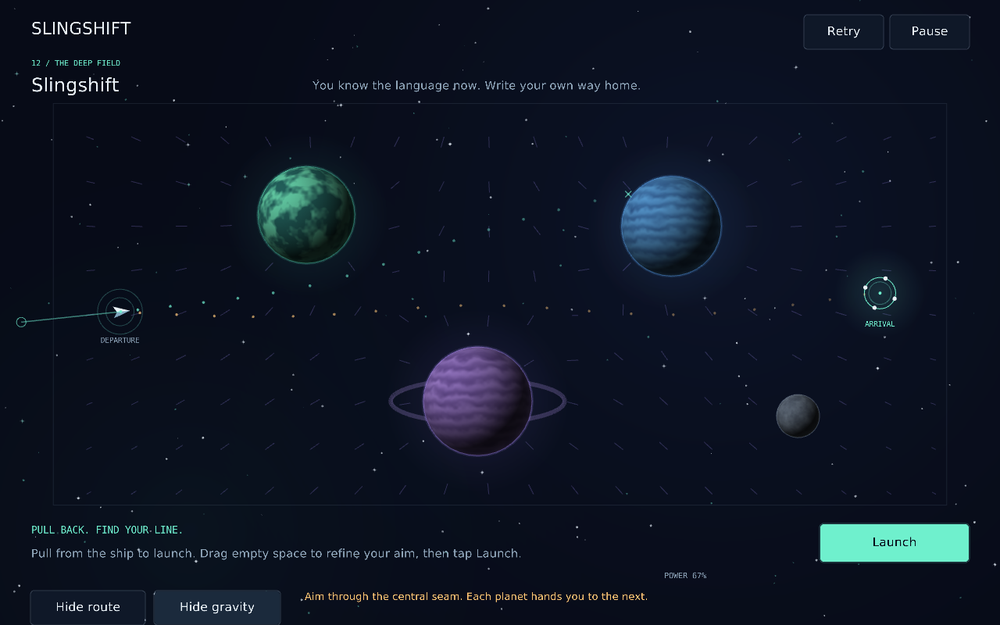
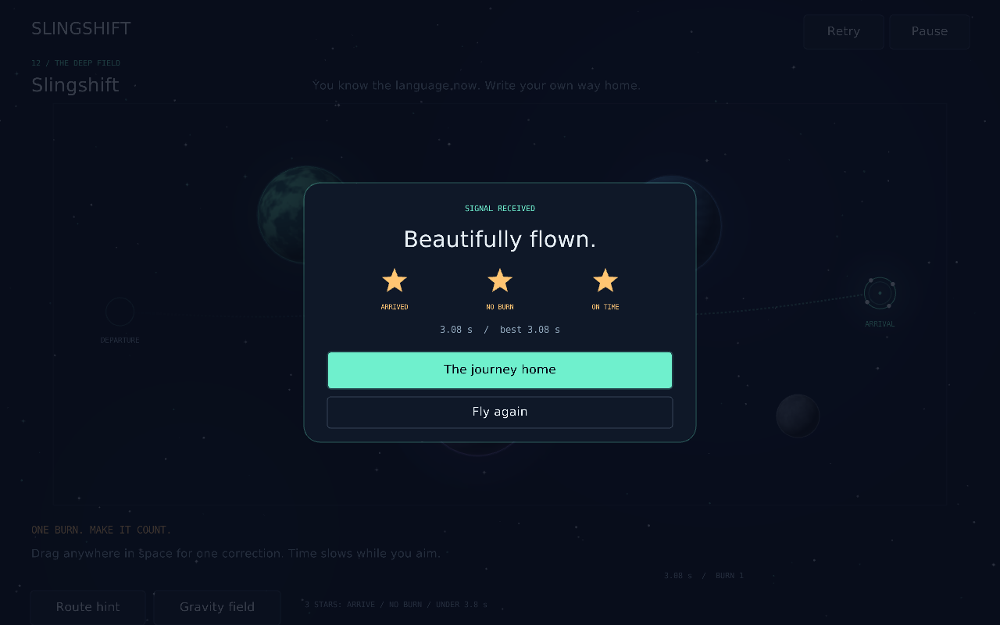

# SLINGSHIFT

**A little thrust. A lot of gravity. Find your line.**

[](https://samykar.itch.io/slingshift)

**[▶ Play SLINGSHIFT on itch.io](https://samykar.itch.io/slingshift)** · Free, browser-playable · [Build from source](#build) · [Technical documentation](docs/PHYSICS.md)

*Cover artwork is promotional; the gameplay screenshots below are from the actual game.*

SLINGSHIFT is a complete, compact orbital puzzle game built in C++20 with raylib. Pull back from your spacecraft, read the projected path, and release. Planets bend your route; stars and rocks punish a careless line. There are twelve signals to find, thirty-six stars to earn, and one emergency burn per flight.

No accounts, servers, paid APIs, runtime downloads or network connection are required after loading the game.



## Play

**Browser:** [Play the published release](https://samykar.itch.io/slingshift) on itch.io. No installation is required.

**Windows:** For a desktop release archive, extract the entire Windows ZIP and open `slingshift.exe`. Keep its `assets` directory alongside it. For the browser build, upload the web ZIP to itch.io, or serve its extracted directory over HTTP:

```sh
python3 -m http.server 8000
```

Open `http://localhost:8000`. Opening `index.html` directly as a local file will usually prevent WebAssembly/data loading. The browser package has `index.html` at its root.

### Controls

| Action | Mouse / touch | Keyboard |
| --- | --- | --- |
| Launch | Pull backward from the ship, then release | Space |
| Refine a staged route | Drag empty space; release holds the new aim; press Launch | Left / Right rotate; Up / Down or + / - change power |
| Fine adjustments | Empty-space drags use a much lower sensitivity | Hold Shift while adjusting |
| Emergency correction | In flight, pull anywhere and release; time slows while aiming | Arrows choose direction; Space burns |
| Retry immediately | Retry button | R |
| Pause / resume | Pause / Resume | Escape or P |
| Menu navigation | Click / tap | Tab, Shift+Tab, Enter |
| Fullscreen | Settings | F11 |

The green ring is the destination. All planet and star surfaces, and all gray rocks, are solid hazards. The dotted line uses the same integrator and collision code as your spacecraft. Route hints and a gravity field overlay are available without a scoring penalty.

Every arrival earns one star. An unused correction burn earns another. Arriving under the displayed par time earns the third. Any arrival unlocks the next signal; you can replay completed levels to improve stars or time.

The first signal teaches slingshot input and the correction burn interactively. Portrait and landscape layouts are supported. Portrait mode also includes power buttons. The fine-aim gesture makes small corrections possible without needing subpixel pointer hardware.

## Build

raylib **5.5 is vendored** at a fixed commit. No dependency fetch happens during configuration. CMake 3.21+ and a C++20 compiler are required. Ninja is optional.

### Windows / Visual Studio

Install Visual Studio 2022 with **Desktop development with C++**, the Windows SDK, and CMake tools. Open this project folder in Visual Studio, or use a Developer PowerShell:

```powershell
cmake --preset windows-vs2022
cmake --build --preset windows-release
ctest --preset windows-release
.\build\vs2022\Release\slingshift.exe
```

Alternatively, select any installed Visual Studio generator with `cmake -G`. The `assets` folder is copied next to the executable automatically. The supplied Windows executable was cross-compiled with MinGW, rather than built by Visual Studio. See [the validation report](docs/VALIDATION.md) for the exact platform coverage.

### Linux

On Ubuntu/Debian, install the normal C/C++ build tools plus X11/OpenGL development packages:

```sh
sudo apt-get install build-essential cmake ninja-build libx11-dev libxrandr-dev \
  libxinerama-dev libxcursor-dev libxi-dev libgl1-mesa-dev libasound2-dev
cmake --preset desktop
cmake --build --preset desktop
ctest --preset desktop
./build/desktop/slingshift
```

### Browser / WebAssembly

Activate an [Emscripten SDK](https://emscripten.org/docs/getting_started/downloads.html) before configuring:

```sh
emcmake cmake -S . -B build/web -G Ninja -DCMAKE_BUILD_TYPE=Release -DSLINGSHIFT_BUILD_TESTS=OFF
cmake --build build/web
python3 tools/package_release.py --web build/web
python3 -m http.server --directory build/web 8000
```

Emscripten 3.1.6 was built and tested here. `web/legacy_glfw.h` covers two window-management APIs missing from that old GLFW port; the game explicitly sizes the canvas from CSS. Newer Emscripten versions use their own implementations. `MINIFY_HTML=0` avoids an HTML-minifier bug in the tested SDK packaging. Modern SDK builds are configured but not claimed as tested.

### Headless tests

The physics and save-format tests require no raylib, display, audio device or graphics driver:

```sh
cmake --preset headless-tests
cmake --build --preset headless-tests
ctest --preset headless-tests
```

For AddressSanitizer and UndefinedBehaviorSanitizer, add `-DSLINGSHIFT_SANITIZE=ON` to a fresh Debug configuration. Some restricted containers cannot run LeakSanitizer; the validation report records that limitation.

An optional Playwright suite plays every level using actual input, verifies progression, and checks failure, pause, correction and mobile touch behavior:

```sh
emcmake cmake -S . -B build/web-qa -G Ninja -DCMAKE_BUILD_TYPE=Release \
  -DSLINGSHIFT_BUILD_TESTS=OFF -DSLINGSHIFT_TEST_HOOKS=ON
cmake --build build/web-qa
npm install --no-save playwright
npx playwright install chromium
node tools/browser_qa.cjs
```

Set `SLINGSHIFT_BROWSER` to an existing Chromium executable if needed. The suite starts its own local HTTP server. `SLINGSHIFT_TEST_HOOKS` is off by default and must stay off for public builds. Test reports and screenshots go to `build/browser-qa/`.

## Inside the project

| File | Responsibility |
| --- | --- |
| `src/physics.*` | Double-precision vectors, gravity, velocity Verlet, swept collisions, prediction, burn limits and scoring; no raylib dependency |
| `src/levels.cpp` | Twelve hand-arranged levels and verified launch vectors |
| `src/game.*` | Input, menus, tutorial, progression, fixed-step clock, particles and responsive layout |
| `src/art.*` | Deterministic procedural planet textures, starfield, spacecraft, rings and typography |
| `src/audio.*` | Procedural sound effects and a quiet synthesized ambient bed |
| `src/save.*` | Versioned progress/preferences; browser localStorage or desktop data directory |
| `src/web_input.*` | Small Pointer Events bridge; keeps short taps and captured drags for the C++ input loop |
| `tests/` | Independent numerical, collision, replay, scoring, level and save-format checks |
| `tools/solve_levels.cpp` | Offline route search used to verify level layouts; never runs during play |
| `tools/make_artwork.cpp` | Reproducible cover and icon renderer using the game's own graphics |
| `tools/package_release.py` | Source and distribution packaging, ZIP checks and SHA-256 hashes |

The gravity model is deliberately simplified: celestial bodies remain fixed, the spacecraft has no effect on them, gravity is softened near a body's center, and arrival gates capture at any speed. This is a game, not an accurate orbital simulator. [Physics notes](docs/PHYSICS.md) explain the equations and limits.



## Progress and privacy

Browser saves use `localStorage` under `slingshift.save.v1`. Windows saves live in `%LOCALAPPDATA%\Slingshift\progress.txt`; Linux uses `$XDG_DATA_HOME/slingshift/progress.txt`, or `~/.local/share/slingshift/progress.txt`. Desktop saves retain one previous backup. Browser saves depend on the site's storage origin; a localhost save will not automatically move to itch.io, and private browsing may discard it.

The game sends no analytics, advertising, telemetry or save data. The hosting service may have its own policies. If storage is unavailable, the game remains playable and shows a save warning.

## Release and license

- [Publishing on itch.io and GitHub](docs/PUBLISHING.md)
- [Store description](docs/ITCH_DESCRIPTION.md)
- [Release checklist](docs/RELEASE_CHECKLIST.md)
- [Validation status and known limits](docs/VALIDATION.md)
- [Third-party notices](THIRD_PARTY_NOTICES.md)

The game code and original procedural artwork/audio use the [MIT license](LICENSE). raylib and the bundled fonts retain their own licenses. Source and binary distributions include the relevant notices.

## Credits

**Created by Sam Y. Karabacak.**

See [CREDITS.md](CREDITS.md) for the project credit and [THIRD_PARTY_NOTICES.md](THIRD_PARTY_NOTICES.md) for license notices.
